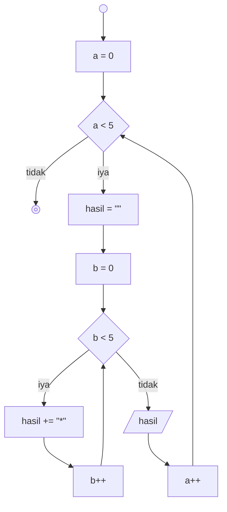
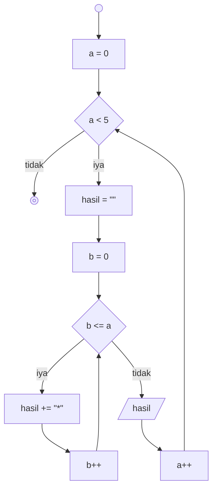

# Minitask 3

## Perulangan pola 1



## Perulangan pola 2



## Perulangan pola 3

```mermaid
  flowchart TD

  A@{shape: sm-circ, label: "start"}
  B@{shape: fr-circ, label: "end"}
  C@{shape: rect, label: "k = 0"}
  D@{shape: rect, label: "b = 0"}
  E@{shape: rect, label: "k++"}
  F@{shape: rect, label: "b++"}
  G@{shape: rect, label: "hasil = ""}
  H@{shape: rect, label: "b++"}
  I@{shape: diam, label: "k < 5"}
  J@{shape: diam, label: "b < 10"}
  K@{shape: diam, label: "b < 5"}
  L@{shape: lean-r, label: "hasil"}

  A --> C --> I --TRUE--> G --> D --> J -->

  I --FALSE--> B

```
